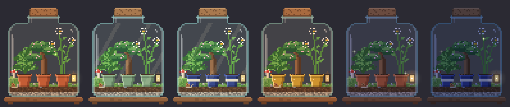
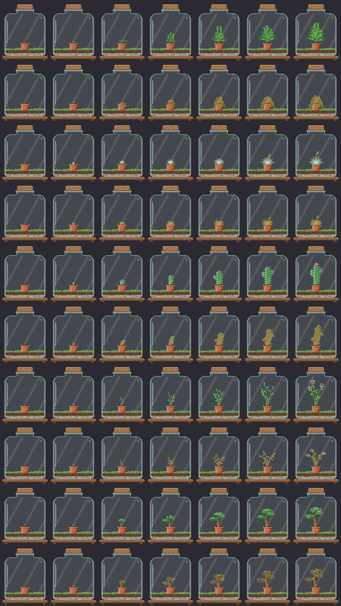

# Terrarium

A tiny glass terrarium that lives in the corner of your Windows desktop. The plants grow while you're doing focused work and slowly droop if you spend too long on distractions. It's a cozy, ambient nudge, not a blocker: nothing is ever closed or locked, and the plants never die.



## Install

1. Download **Terrarium.exe** from the [latest release](https://github.com/larosa023/Terrarium/releases/latest).
2. Put it somewhere you own, ideally `%LOCALAPPDATA%\Programs\Terrarium\` (the updater needs to be able to replace the file, so avoid `Program Files`).
3. Run it. Windows SmartScreen may warn because the exe isn't code-signed yet: **More info → Run anyway**.

A fern seed appears above your taskbar. Drag it anywhere; it snaps to screen edges.

## How it works

| You're… | What happens |
|---|---|
| In a **focus** app (VS Code, Excel, Bluebeam, PlanSwift, Gridline…) | Plants grow and recover |
| On a **distraction** (YouTube, Reddit, Steam…) | Nothing for the first 3 minutes, then a gradual droop |
| In anything else | Neutral. Doesn't help or hurt (and doesn't reset a distraction streak) |
| Away (no input for 3 min), locked, or asleep | Nothing counts either way |
| Paused (tray menu) | Nothing counts |

- **Rules:** *App name is* matches the executable (`EXCEL`, `Code`). *Window title has* matches any window title, so it catches websites in every browser. Title rules win over app rules, so `chrome` stays neutral while `… - YouTube - Google Chrome` is a distraction. Settings → *Apps & sites* lists the apps you've recently used so you can mark them in one click.
- **Wilting** takes about 90 minutes of continuous distraction to bottom out; about 30 minutes of focus brings a plant fully back. Droopy plants grow at 40–100% speed depending on health.
- **Growth stages** (focused hours per plant): Seed → Sprout (20 min) → Young (1.5 h) → Leafy (4 h) → Mature (9 h) → Blooming (16 h). At a few hours of focus a day, that's days to weeks.
- **Unlocks** (lifetime focused hours):
  - Plants: Fern (start), Succulent 2 h, Cactus 6 h, Daisy 12 h, Bonsai 25 h
  - Extra pots: second at 3 h, third at 10 h (each starts with a new seed)
  - Pot styles: Terracotta, Sage 4 h, Indigo 15 h, Gilded 40 h
  - Decorations: Pebbles 1 h, Moss 5 h, Mushroom 8 h, Lantern 20 h (glows at night), Snail 30 h, Fireflies 50 h
- **Light** follows your clock: warm dawn, bright day, golden dusk, blue night.



### Controls

- **Drag** to move · **Ctrl + scroll** to resize · **Double-click** for the summary · **Right-click** (or the tray icon) for the menu
- Tray menu: show/hide, size, Garden (replant a pot, pot style, decorations), Summary, Pause tracking, Settings, Check for updates, Quit
- Settings: always on top, hide during fullscreen, start with Windows, idle and grace times, daily/weekly recaps, rules, updates, data folder, reset

## Privacy

Everything stays on your PC in `%LOCALAPPDATA%\Terrarium` (`settings.json`, `garden.json`). Terrarium stores only time totals per day; window titles are matched against your rules in memory and never written to disk. The only network request is the optional once-a-day update check to the GitHub API, which sends nothing about you.

## Performance

- Animation runs at 8 fps and **stops** when a fullscreen app is in front, when you're away, or when the widget is hidden. A fully decorated frame renders in under 1 ms.
- Activity sampling is one cheap Win32 query per second.
- Typical memory is in the tens of MB (it's a .NET/WPF app); Terrarium trims its working set after startup and when hidden.

## Updates

Terrarium checks `larosa023/Terrarium` releases once a day (can be turned off). When a newer version exists you get a notification; installing downloads the new exe, verifies its SHA-256, swaps it in place and restarts. Your garden carries over. You can skip a version or check manually from the tray.

---

## Development

**Stack:** C# / .NET 10, WPF for the transparent widget and settings windows, WinForms only for the tray icon. All game logic and the pixel-art renderer live in a dependency-free core library, so they build and test on any OS.

```
Terrarium/
├─ src/
│  ├─ Terrarium.Core/            # platform-neutral, no dependencies
│  │  ├─ Activity/               # ActivityKind, ActivityClassifier (rules → focus/distraction)
│  │  ├─ Garden/                 # Catalog (plants, pots, decor, thresholds), GardenEngine (grow/wilt/unlock)
│  │  ├─ Model/                  # Settings, GardenState, Stats
│  │  ├─ Rendering/              # PixelCanvas, TerrariumRenderer (procedural 64×80 art), IconArt
│  │  ├─ Storage/                # JsonStore (atomic saves, corrupt-file recovery)
│  │  └─ Updates/                # GitHub release parsing, version compare, checksum parsing
│  └─ Terrarium.App/             # Windows shell (WinExe → Terrarium.exe)
│     ├─ AppController.cs        # main loop, tray menu, saving, recaps, update flow
│     ├─ Interop/Native.cs       # Win32: foreground window, idle time, fullscreen, window styles
│     ├─ Services/               # ActivityMonitor, Updater, StartupManager, AppPaths
│     └─ Views/                  # WidgetWindow, TrayIcon, SettingsWindow, SummaryWindow, IconFactory
├─ tests/Terrarium.Core.Tests/   # dependency-free test runner
├─ tools/Terrarium.Preview/      # renders art preview PNGs + regenerates the .ico
├─ .github/workflows/            # build.yml (every push), release.yml (on v* tags)
└─ build.ps1                     # local build
```

### Build and run on Windows

Install the [.NET 10 SDK](https://dotnet.microsoft.com/download/dotnet/10.0), then:

```powershell
.\build.ps1 -Run          # tests, publishes dist\Terrarium.exe, launches it
dotnet run --project src/Terrarium.App   # or run a debug build directly
```

### Test and preview (any OS)

```bash
dotnet run --project tests/Terrarium.Core.Tests
dotnet run --project tools/Terrarium.Preview -- preview                                  # PNG sheets into ./preview
dotnet run --project tools/Terrarium.Preview -- preview --icon src/Terrarium.App/Assets/terrarium.ico
```

### Releasing

1. Bump `<Version>` in `Directory.Build.props` (optional; CI uses the tag).
2. `git tag v0.2.0 && git push origin v0.2.0`
3. The Release workflow tests, builds a self-contained single-file `Terrarium.exe`, writes `Terrarium.exe.sha256`, and publishes the GitHub Release. Installed copies pick it up within a day.

Tip: to try the updater, install a release, then push a higher tag.

### Ideas for later

Code signing (removes the SmartScreen prompt) · watering/tapping interactions · seasonal decorations · more species · per-app focus multipliers · a "focus session" timer · export stats to CSV.
